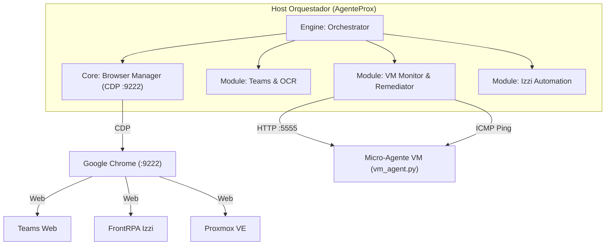

# SPEC-01: Arquitectura del Sistema y Ciclo Orquestador

## 1. Alcance
Define la estructura de alto nivel del sistema AgenteProx, la comunicación con el navegador a través del protocolo Chrome DevTools Protocol (CDP), la tolerancia a fallos y el bucle principal de vigilancia.

## 2. Topología de Red y Conectividad
- **Orquestador (Host):** Ejecuta el motor principal sobre Python en Windows.
- **Chrome CDP (`localhost:9222`):** Instancia de navegador controlada de forma desasistida. Aloja las sesiones autenticadas de Teams, portal izzi y Proxmox VE.
- **Nodos Remotos (VMs Proxmox):** Segmentos de red `192.168.48.0/24`, `192.168.49.0/24`, `192.168.51.0/24`, `192.168.61.0/24`.
- **Micro-Agente VM (`TCP 5555`):** Servidor HTTP embebido en cada máquina virtual Windows.

## 3. Componentes del Software

## 4. Ciclo de Vida del Bucle Principal (`Orchestrator`)
1. **Conexión / Reconexión CDP:**
   - Intentar conectar a `http://localhost:{DEBUG_PORT}` (timeout 15s).
   - Localizar páginas activas (`:8006`, `teams.microsoft.com`, `frontrpaizzi`).
   - Aplicar el parche de visibilidad (`document.visibilityState = 'visible'`).
   - Emitir mensaje de inicio de ciclo al canal de Teams configurado.
2. **Chequeo Inicial de Soporte:**
   - Inspeccionar el chat de soporte en busca de solicitudes pendientes no leídas.
3. **Escaneo Secuencial del Inventario de VMs:**
   - Por cada VM en la lista:
     - Realizar chequeo intermedio de soporte en Teams (para no retrasar respuestas humanas).
     - Si la iteración es múltiplo de 5, disparar Keep-Alive anti-sueño a la pestaña de izzi.
     - Inspeccionar estado visual en Proxmox si la pestaña existe.
     - Consultar estado del proceso vía HTTP `GET /status`.
     - Si está `sin_proceso`, ejecutar arranque automático (`POST /start`), esperar 12s y revalidar.
     - Si la máquina es VIX18 (`130(vix18)`), desencadenar el escaneo secundario de las 38 máquinas hijas.
     - Filtrar alertas contra la lista negra y la caché de deduplicación diaria (`IP|resultado|fecha`).
4. **Espera Activa de Soporte (30 Minutos):**
   - Ejecutar un ciclo de 60 iteraciones de 30 segundos.
   - En cada iteración:
     - Verificar la salud de la conexión del navegador.
     - Revisar si ha llegado un nuevo mensaje en el grupo de soporte.
     - Cada 5 minutos (10 pasos), ejecutar ping anti-sueño en izzi.
   - Reiniciar el ciclo completo de escaneo tras cumplirse el tiempo.

## 5. Tolerancia a Fallos y Excepciones
- Si el navegador Chrome es cerrado manualmente o se reinicia, se lanza `BrowserClosedError`.
- El orquestador captura `BrowserClosedError`, establece `browser = None` y continúa el escaneo por HTTP/ICMP sin abortar el proceso.
- En el siguiente ciclo o paso de espera activa, se reintenta la conexión automáticamente.
