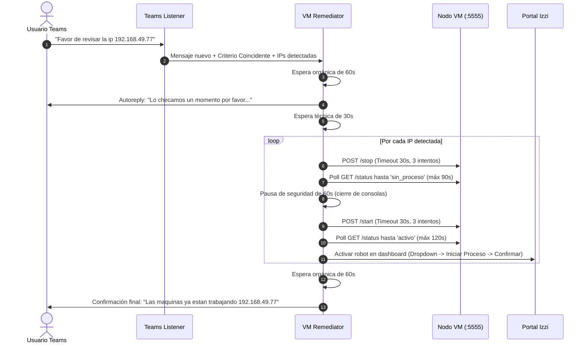

# SPEC-04: Flujo de Remediación y Soporte de VMs

## 1. Alcance
Define la máquina de estados y temporizadores involucrados en la atención automatizada de solicitudes de soporte desde Teams y la auto-recuperación de bots inactivos.

## 2. Diagrama de Flujo de Soporte y Remediación

## 3. Temporizadores Críticos
- **Espera previa al Autoreply:** `60 segundos` (imita el tiempo de lectura humano).
- **Espera post-Autoreply:** `30 segundos` antes de iniciar la remediación.
- **Timeout confirmación STOP:** `90 segundos` con sondeo cada `3 segundos`.
- **Pausa de Seguridad STOP $\to$ START:** `60 segundos` indispensables para asegurar que las conexiones de red y sesiones de consola cierren limpiamente en Windows.
- **Timeout confirmación START:** `120 segundos` con sondeo cada `3 segundos`.
- **Espera previa a Confirmación Final:** `60 segundos`.

## 4. Gestión de Reintentos de Conexión
Toda llamada HTTP a los micro-agentes de las VMs debe:
- Ignorar proxies del sistema (`proxies={"http": None, "https": None}`).
- Realizar hasta 3 intentos con pausas de 2 segundos en caso de fallo transitorio.
- Precalentar la ruta de red con un paquete ICMP (`is_pingable`).
